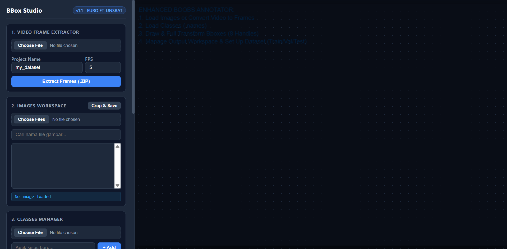

# BBox Annotation Tool - for YOLO dataset training



An interactive browser-based image annotation web application designed specifically to accelerate the workflow of creating and managing bounding box object detection datasets (YOLO, VOC, COCO).

## Key Features & Improvements
This tool is an evolution and advanced improvement of **boobs master**, packed with modern productivity enhancements:

1. **Direct Class Creator**
   Add and manage classes directly within the interface (*inline*) without the hassle of creating and loading external `classes.txt` files.

2. **Video to Frame Extractor**
   Convert video files (`.mp4`, `.avi`, `.mkv`) directly in the browser into `.jpg` image frames ready for annotation, complete with custom FPS and project naming settings.

3. **8-Handle Full Transform BBox**
   Refined annotation box control featuring 8 transformation handles (4 corners and 4 edge centers) to significantly speed up bounding box resizing and adjustments.

4. **Advanced Dataset Splitter & Exporter**
   Manage Output Workspace to manually configure dataset split percentages (*Train*, *Validation*, *Test*)—including full support for a `0%` Test option—complete with automated `classes.txt` generation in the root ZIP folder, ready for YOLO training.

5. **Modern Dark UI Design**
   A clean, modern dark-mode engineering studio interface featuring modular cards and a dot-grid canvas, designed for comfortable long-session annotating.

## Quick Start
1. Clone or download this repository.
2. Open the `studio.html` file directly in any modern web browser (Chrome, Firefox, Edge).
3. Load images or use the video extraction feature to start building your dataset.

## YOLO Dataset Output Structure
Upon clicking the **Set Up Dataset** button, the downloaded ZIP archive will feature a clean, standard directory structure:
```text
Dataset_my_dataset/
├── classes.txt          (Class list ordered line-by-line, ready for YOLO training)
├── Train/
│   ├── images/          (Training image files)
│   └── frame/           (YOLO format label .txt files)
├── Val/
│   ├── images/          (Validation image files)
│   └── frame/           (YOLO format label .txt files)
└── Test/
    ├── images/          (Testing image files, if enabled)
    └── frame/           (YOLO format label .txt files)
